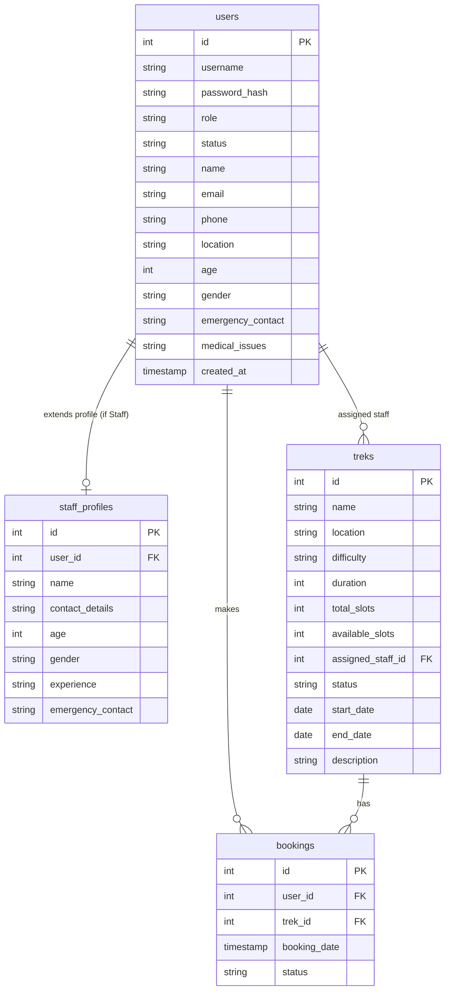

# 🏔️ Trekking Management Application

A comprehensive Web Application built with **Flask** and **SQLite** to manage trekking expeditions, bookings, staff allocations, and user directories. This project features full role-based access control (RBAC), administrative oversight, responsive styling, and custom dashboards for Admins, Trek Staff, and Trekkers.

---

## 🚀 Key Features

### 👤 Role-Based Access Control (RBAC)
*   **Admin Dashboard**:
    *   Approve or blacklist users and staff members.
    *   Create, view, update, and delete trek trails.
    *   Monitor system bookings and manage trek staff assignments.
    *   Visual statistics of bookings, users, and overall metrics.
*   **Trek Staff Dashboard**:
    *   View details of assigned treks and check-ins.
    *   Manage and update personal profile, experience, and emergency contact details.
*   **Trekker (User) Dashboard**:
    *   Explore and search available trek itineraries.
    *   Book slots for upcoming expeditions.
    *   Track personal booking history and current status.
    *   Manage personal profiles, including medical details and emergency contacts.

---

## 🛠️ Technology Stack
*   **Backend**: Python, Flask
*   **Database**: SQLite (SQLAlchemy ORM/Direct sqlite3 engine with migrations)
*   **Frontend**: HTML5, Vanilla CSS, JavaScript
*   **Security & Auth**: Werkzeug security hashing, Session-based authentication & route security wrappers

---

## 📂 Project Structure
```text
Trekking-Management-Application/
├── static/
│   └── css/
│       └── style.css          # Custom styling sheet
├── templates/
│   ├── admin_*.html           # Administrative interface pages
│   ├── staff_*.html           # Trek staff interface pages
│   ├── trekker_*.html         # Trekker interface pages
│   ├── base.html              # Standard structural layout base
│   ├── home.html              # Landing and portal index page
│   └── login.html / register  # Authenticating entryways
├── app.py                     # Main Flask Application & controller logic
├── database.py                # Database schema definition, migration & seeding
├── trekking.db                # SQLite database (auto-generated)
└── README.md                  # Project documentation
```

---

## 🗄️ Database Schema & Relationships

The SQLite database is initialized programmatically with the following structure:



---

## 🌐 API Directory

All administrative resource management endpoints return JSON payloads and require Admin authentication:

*   `GET /api/treks` — Retrieve lists of all treks.
*   `POST /api/treks` — Programmatically create a new trek.
*   `GET /api/treks/<id>` — View details of a specific trek.
*   `PUT /api/treks/<id>` — Edit parameters of a trek.
*   `DELETE /api/treks/<id>` — Remove a trek trail.
*   `GET /api/users` — Read-only directory of all registered users.
*   `GET /api/bookings` — Access the global registry of all reservations.

---

## ⚙️ Local Setup Instructions

### 1. Clone the repository
```bash
git clone https://github.com/24f2007550/Trekking-Management-Application.git
cd Trekking-Management-Application
```

### 2. Set up virtual environment
```bash
python -m venv venv
# On Windows
venv\Scripts\activate
# On macOS/Linux
source venv/bin/activate
```

### 3. Install dependencies
Ensure Flask is installed:
```bash
pip install flask
```

### 4. Run the Application
Start the development server:
```bash
python app.py
```
Open `http://127.0.0.1:5000` in your web browser.

---

## 🔑 Seeding / Default Credentials
The application automatically creates a default administrator account on startup:
*   **Username**: `admin`
*   **Password**: `admin123`