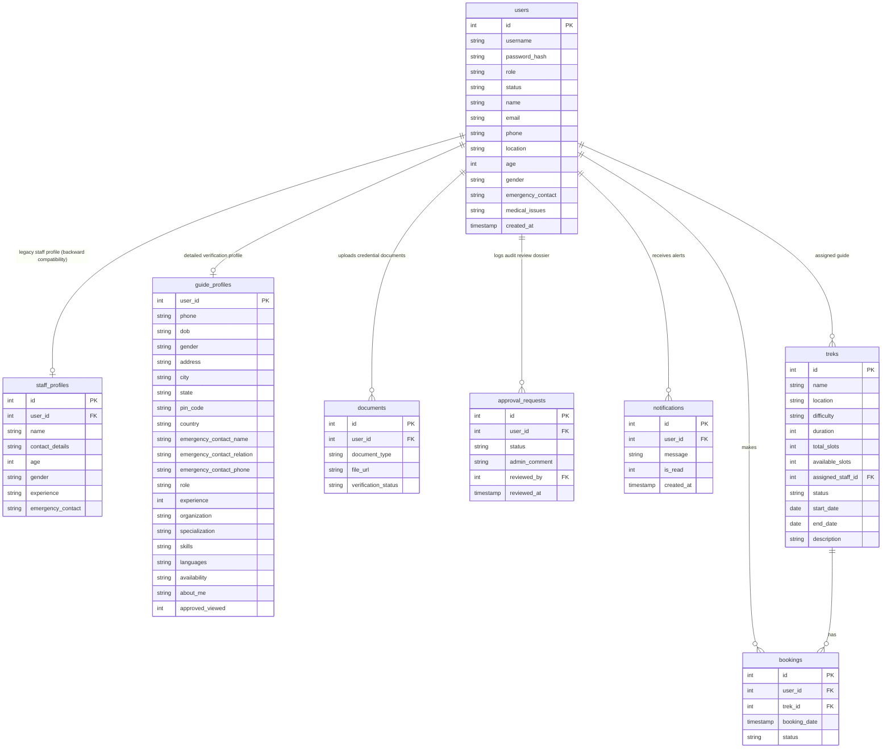

# 🏔️ Trekking Management Application

A comprehensive Web Application built with **Flask** and **SQLite** to manage trekking expeditions, bookings, staff allocations, and user directories. This project features full role-based access control (RBAC), administrative oversight, responsive styling, and custom dashboards for Admins, Trek Staff, and Trekkers.

---

## 📽️ Project Media & Reports
*   **Project Report**: [Download / View PDF](https://drive.google.com/file/d/1yik1SxrOM8XsPHTICfXtayIKK2S2X3Zy/view?usp=drive_link)

---

## 🚀 Key Features

### 👤 Role-Based Access Control (RBAC)
*   **Admin Dashboard**:
    *   Approve or blacklist users and staff members.
    *   Dedicated **Guide & Staff Verification Dossier** system to review applications.
    *   Request changes with feedback or reject/approve profiles.
    *   Create, view, update, and delete trek trails.
    *   Monitor system bookings and manage trek staff/guide assignments.
    *   Visual statistics of bookings, users, and overall metrics.
*   **Trek Staff & Guides**:
    *   **Approval & Verification Workflow**: Newly registered Guides/Staff are restricted from accessing dashboard management features until they fill out a 12-section Verification Form and are approved by an Admin.
    *   **Wizard Verification Profile**: Multi-section wizard form (Personal details, Address, emergency contact, experience, skills checklist, languages, availability, and certificates/resume uploads).
    *   **Pending Dashboard**: Progress tracker showing review steps, admin changes requested feedback banners, and contact information.
    *   **Success Landing**: Celebratory congratulations page upon first login post-approval.
    *   View details of assigned treks and check-ins.
    *   Manage and update personal profile, experience, and emergency contact details.
*   **Trekker (User) Dashboard**:
    *   Explore and search available trek itineraries.
    *   Book slots for upcoming expeditions.
    *   Track personal booking history and current status.
    *   Manage personal profiles, including medical details and emergency contacts.

---

## 🛠️ Technology Stack
*   **Backend**: Python, Flask
*   **Database**: SQLite (direct sqlite3 connection engine with schemas)
*   **Frontend**: HTML5, Bootstrap 5, Vanilla CSS, JavaScript
*   **Security & Auth**: Werkzeug security hashing, Session-based auth, real-time `app.before_request` status interceptor guards.
*   **File Uploads**: Secure file uploads (PDF, JPG, PNG, DOCX; limit 5MB per file) stored in `static/uploads/`.

---

## 📂 Project Structure
```text
Trekking-Management-Application/
├── static/
│   ├── css/
│   │   └── style.css                 # Custom styling sheet (added wizard, timeline, animations)
│   └── uploads/                      # Secure directory for document uploads (ignored in git)
├── templates/
│   ├── admin_dashboard.html          # Administrative stats page
│   ├── admin_staff.html              # Guide allocation registry
│   ├── admin_users.html              # User management registry
│   ├── admin_verifications.html      # NEW: Dedicated guide verifications directory
│   ├── admin_review.html             # NEW: Verification dossier detailed review panel
│   ├── pending_dashboard.html        # NEW: Wait screen with progress tracking
│   ├── verification_form.html        # NEW: 12-section wizard-style profile form
│   ├── approval_success.html         # NEW: Celebratory redirect layout
│   ├── staff_dashboard.html          # Trek staff dashboard
│   ├── staff_profile.html            # Staff profile details
│   ├── trekker_dashboard.html        # Trekker interface pages
│   ├── base.html                     # Standard navbar base (updated for Guides)
│   └── home.html                     # Landing and portal index page
├── app.py                            # Main Flask application & routes (added workflow handlers)
├── database.py                       # Database schema definition, migration & seeding
├── trekking.db                       # SQLite database (auto-generated)
├── email_logs.txt                    # Local mock email logs (auto-generated)
└── README.md                         # Project documentation
```

---

## 🗄️ Database Schema & Relationships

The SQLite database is initialized programmatically with the following structure:



---

## 🌐 API Directory

All administrative resource management endpoints return JSON payloads and require Admin authentication:

*   `GET /api/treks` — Retrieve lists of all treks.
*   `POST /api/treks` — Programmatically create a new trek.
*   `GET /api/treks/<id>` — View details of a specific trek.
*   `PUT /api/treks/<id>` — Edit parameters of a trek.
*   `DELETE /api/treks/<id>` — Remove a trek trail.
*   `GET /api/users` — Read-only directory of all registered users.
*   `GET /api/bookings` — Access the global registry of all reservations.

---

## ⚙️ Local Setup Instructions

### 1. Clone the repository
```bash
git clone https://github.com/24f2007550/Trekking-Management-Application.git
cd Trekking-Management-Application
```

### 2. Set up virtual environment
```bash
python -m venv venv
# On Windows
venv\Scripts\activate
# On macOS/Linux
source venv/bin/activate
```

### 3. Install dependencies
Ensure Flask and BeautifulSoup4 (used for testing) are installed:
```bash
pip install flask beautifulsoup4 requests
```

### 4. Run the Application
Start the development server:
```bash
python app.py
```
Open `http://127.0.0.1:5000` in your web browser.

---

## 🔑 Seeding / Default Credentials
The application automatically creates default administrative and demo details on startup:
*   **Admin Username**: `admin`
*   **Admin Password**: `admin123`
